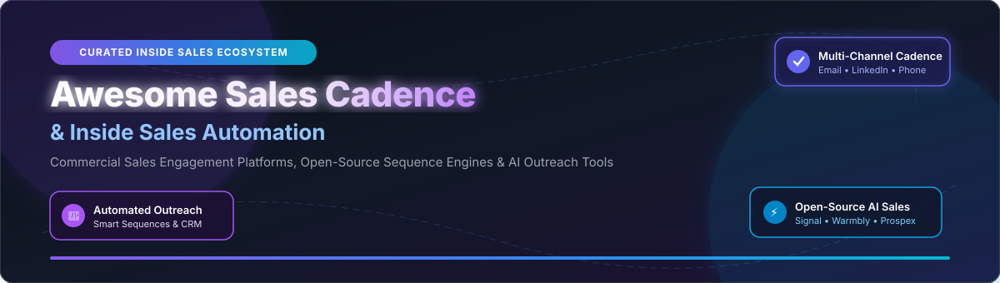

# 🚀 Awesome Sales Cadence & Inside Sales Automation

  

  
  
  
  
  

---

## 🎯 Executive Overview & SEO Meta Summary

Welcome to the definitive **Awesome Sales Cadence & Inside Sales** ecosystem directory! This repository tracks leading commercial **Sales Engagement Platforms (SEPs)**, **inside sales automation tools**, **multi-channel outreach cadences** (email, phone, LinkedIn, WhatsApp, social DMs), and self-hosted **open-source sales intelligence & sequence engines**. 

Whether you are an Enterprise VP of Revenue Operations building a multi-channel outbound cadence, a Sales Development Representative (SDR) looking for personalized cold email automation, or an engineer deploying self-hosted AI sales agents, this curated directory provides comprehensive benchmarks on **pricing, free tier limits, company valuation/revenue, and GitHub star trends**.

---

## 📚 Table of Contents

- [📊 Sector Market Size & Industry Dynamics](#-sector-market-size--industry-dynamics)
- [🏢 SaaS & Hosted Commercial Platforms](#-saas--hosted-commercial-platforms)
- [🔓 Open-Source GitHub Projects](#-open-source-github-projects)
- [🤝 How to Contribute](#-how-to-contribute)
- [💖 Support & Sponsorship](#-support--sponsorship)
- [⚠️ Disclaimer & Compliance](#%EF%B8%8F-disclaimer--compliance)
- [📈 Star History](#-star-history)

---

## 📊 Sector Market Size & Industry Dynamics

> 💡 **Market Size & Structure**: The global **Sales Engagement Platform & Inside Sales Automation** market is estimated at **$7.45 Billion in 2026** and projected to reach **$18.6 Billion by 2032** at a **16.5% CAGR**. The sector is **moderately fragmented** — enterprise consolidation is led by heavyweights like Salesforce, Outreach, and Salesloft (which hold winner-take-most positioning in the $100M+ ARR enterprise segment), alongside a hyper-active SMB tier (Apollo.io, Lemlist, Mixmax) and a rapidly surging self-hosted open-source ecosystem (OpenOutreach, Signal, Prospex, Warmbly).

---

## 🏢 SaaS & Hosted Commercial Platforms

Below is a detailed comparison of top commercial Sales Cadence and Sales Engagement Platforms, sorted in **descending order by Company Size (Revenue / Valuation)**.

| 🏢 Platform | 💰 Company Valuation / Revenue | 💳 Starting Tier Pricing | 🆓 Free Tier / Trial Limits | 🌟 Key Strengths & Target Use Case |
| :--- | :--- | :--- | :--- | :--- |
| **[Salesforce Sales Engagement](https://www.salesforce.com/)** | **~$280B Valuation** ($34.8B Annual Rev) | **$75/user/month** *(Requires Sales Cloud Enterprise at $165/mo; total $240/mo)* | **30-Day Free Trial** *(Includes pre-populated lead data & 100 Einstein Activity Capture credits)* | Native Salesforce work queues, automated cadences, Einstein AI insights, and enterprise telephony integration. Best for enterprise Salesforce teams. |
| **[Outreach](https://www.outreach.io/)** | **$4.4B Valuation** (~$200M+ ARR) | **$100/user/month** *(Base seat tier, billed annually with contract minimum)* | **14-Day Demo Sandbox** *(Custom sandbox environment with 50 email sequence test sends on sales request)* | Market leader in enterprise sales engagement, sequence orchestration, deal health intelligence, and rep execution. Best for data-driven sales organizations. |
| **[Salesloft](https://www.salesloft.com/)** | **$2.3B+ Valuation** (~$150M+ ARR) | **$125/user/month** *(Essentials Plan, billed annually)* | **14-Day Interactive Sandbox** *(Guided sandbox access with template library & 50 call/email sequence runs)* | Enterprise standard for multi-channel cadences, conversation intelligence, and revenue workflow automation. Best for inside sales & BDR/SDR teams. |
| **[Apollo.io](https://www.apollo.io/)** | **$1.6B Valuation** (~$100M+ ARR) | **$49/user/month** *(Basic plan, billed annually at $49 or $59 monthly)* | **Free Forever Plan** *(10,000 email credits/mo, 60 mobile credits/yr, 2 email accounts, basic cadence automation)* | All-in-one B2B contact database (275M+ leads), email sequence engine, dialer, and enrichment platform. Best for SMBs wanting data + outreach in one. |
| **[Groove (by Clari)](https://www.groove.co/)** | **$1.6B Parent Valuation** (~$15M ARR) | **$50/user/month** *(Core seat tier, annual commitment)* | **14-Day Free Trial** *(Includes full Salesforce activity sync test, 100 flow emails, and template tracking)* | Salesforce-native sales engagement platform designed to eliminate admin work and sync rep activities seamlessly. Best for Salesforce-centric revenue teams. |
| **[Lemlist](https://lemlist.com/)** | **~$150M Valuation** (~$25M+ ARR) | **$63/user/month** *(Email Pro plan billed annually at $63/mo or $79 monthly)* | **14-Day Free Trial** *(No credit card required; 100 email verification credits & full lemwarm warmup access)* | Cold email specialist with dynamic text/image personalization, multi-channel cadences (Email, LinkedIn, Calls), and automated warmup. Best for deliverability-focused outreach. |
| **[Mixmax](https://mixmax.com/)** | **~$15M ARR** (Private Bootstrapped) | **$29/user/month** *(Growth plan billed annually at $29/mo or $34 monthly)* | **Free Forever Plan** *(100 email tracks/mo, 10 sequence sends/mo, instant calendar scheduling link)* | Gmail & Outlook power engagement tool featuring inline polls, one-click scheduling links, email sequences, and CRM sync. Best for Gmail power users & SDRs. |
| **[Yesware](https://www.yesware.com/)** | **~$12M ARR** (Acquired by EmberPoint) | **$15/user/month** *(Pro plan billed annually at $15/mo or $19 monthly)* | **14-Day Free Trial** *(No credit card required; unlimited email tracking, 20 attachment views, 100 sequence emails)* | Lightweight email tracking, template management, and sequence automation inside inbox. Best for individual reps, account executives, and boutique teams. |
| **[Mailshake](https://mailshake.com/)** | **~$10M ARR** (Private Bootstrapped) | **$58/user/month** *(Email Outreach plan billed annually at $58/mo or $75 monthly)* | **30-Day Money-Back Guarantee** *(Includes 5,000 email sends and 50 lead cleanup credits during initial 30 days)* | Dedicated cold email outreach platform with integrated VOIP dialer, lead catcher, and automated follow-up sequences. Best for cold email agencies and SDR teams. |
| **[Woodpecker](https://woodpecker.co/)** | **~$6M ARR** (Public: WDP.WA) | **$29/user/month** *(Cold Email plan for 500 contacted prospects/mo)* | **7-Day Free Trial / 50 Sends** *(No credit card required; 50 cold emails sent limit, full sequence builder & deliverability checks)* | Cold email automation engine with deliverability defense, human-like sending pacing, and A/B testing. Best for agencies, SMBs, and deliverability purists. |

---

## 🔓 Open-Source GitHub Projects

Below is the curated list of self-hosted, open-source Sales Cadence, B2B lead generation, and sequence platforms, strictly sorted in **descending order by GitHub Stars_Count**.

- **[OpenOutreach](https://github.com/eracle/OpenOutreach)**   
  ⚡ **Open-source AI agent for B2B lead generation & email outreach** — Describe your product, find matching target personas, analyze buyer intent, and execute personalized cold email sequences automatically from your mailbox. Includes a single-command CLI installer. **Best for AI-driven lead discovery and autonomous cold outreach**.

- **[coldoutboundskills](https://github.com/growthenginenowoslawski/coldoutboundskills)**   
  ⚡ **Open-source Claude Code skills for cold email and outbound sales** — Suite of Claude Code skills for campaign grading, prospect extraction, Google Maps scraping, and automated outreach sequence drafting. **Best for outbound sales teams operating directly in AI developer tools**.

- **[marketing-dashboard](https://github.com/builderz-labs/marketing-dashboard)**   
  ⚡ **Local-first marketing operations and sales outreach control center** — Self-hosted control center for CRM management, cold outreach campaigns, analytics dashboards, approvals, automations, and AI agent workflows. **Best for privacy-conscious teams needing local-first outreach control**.

- **[sales-outreach-automation-langgraph](https://github.com/kaymen99/sales-outreach-automation-langgraph)**   
  ⚡ **Multi-agent AI framework for sales outreach automation built with LangGraph** — Orchestrates lead research, prospect qualification, personalized copy generation, and multi-channel CRM synchronization (HubSpot, Airtable, Google Sheets). **Best for developers building multi-agent sales workflows**.

- **[Warmbly](https://github.com/warmbly/warmbly)**   
  ⚡ **Open-source B2B cold outreach platform and automated email warmup service** — Comprehensive open-source solution to warm up new sending domains, prevent spam classification, and maintain high email deliverability across outreach mailboxes. **Best for deliverability-focused cold email infrastructure**.

- **[Signal](https://github.com/jay-sahnan/signal)**   
  ⚡ **Open-source AI sales intelligence and outreach automation platform** — The open alternative to Clay, Apollo, and Outreach. Built with Next.js 16, Supabase, and Claude AI. Features a signals engine for buying triggers (hiring, funding, news), contact enrichment, and multi-step email sequences with bounce/reply tracking. **Best for signal-based AI sales outreach**.

- **[ColdIQ GTM Skills](https://github.com/Cold-IQ/ColdIQ-s-GTM-Skills)**   
  ⚡ **Go-To-Market and sales cadence skills library** — Repository of 137 sales triggers, 34 cold email sequence templates, 11 GTM outreach plays, and Clay enrichment workflows. **Best for GTM playbook execution and sequence templates**.

- **[Prospex](https://github.com/asiifdev/business-leads-ai-automation)**   
  ⚡ **Open-source AI-powered GTM automation platform** — Self-hosted alternative to Apollo.io + Instantly.ai. Features Google Maps lead discovery with AI lead scoring, multi-channel content generation (Email, WhatsApp, Instagram DM, LinkedIn, Cold Call scripts), and Kanban CRM pipeline management. **Best for SMEs wanting full self-hosted GTM automation**.

- **[Email-automation](https://github.com/PaulleDemon/Email-automation)**   
  ⚡ **Open-source cold email outreach tool** — Lightweight self-hosted tool for automating personalized cold email campaigns, tracking engagement, and scheduling follow-up cadences. **Best for simple, self-hosted email sending**.

- **[yc-outreach](https://github.com/adityajha2005/yc-outreach)**   
  ⚡ **Target batch cold outreach tool** — Scrape YC batch directories, extract founder leads and verified emails, and generate personalized cold outreach emails from custom templates using standard Python. **Best for founder outreach & YC networking**.

- **[Linki](https://github.com/moaljumaa/linki)**   
  ⚡ **Self-hosted LinkedIn outreach automation tool** — Automate LinkedIn connection requests, follow-up direct messages, and sales cadence progress tracking. **Best for self-hosted LinkedIn sales outreach**.

- **[meteor-emails](https://github.com/catin-black/meteor-emails)**   
  ⚡ **Open-source cold email sequence sender** — Free, open-source project designed to eliminate SaaS subscription costs by sending automated cold outreach sequences directly. **Best for zero-cost email campaign execution**.

- **[project-genai-cold-email-generator](https://github.com/codebasics/project-genai-cold-email-generator)**   
  ⚡ **Cold email generator using Llama 3.1 LLM & LangChain** — Automated cold email writer built with Llama 3.1, ChromaDB vector database, and Streamlit frontend. Extracts company job descriptions and drafts tailored cold outreach. **Best for LLM-assisted email drafting**.

- **[linkedin-bot](https://github.com/FujiwaraChoki/linkedin-bot)**   
  ⚡ **Automated LinkedIn outreach bot** — Selenium and GeckoDriver-powered automation script for sending connection invitations, direct messaging cadences, and follow-ups. **Best for browser-based LinkedIn automation**.

- **[Harvey](https://github.com/ethanplusai/harvey)**   
  ⚡ **Autonomous AI sales agent powered by Claude Code** — Autonomous agent that discovers prospective accounts, writes personalized cold sequences, executes campaigns, processes incoming replies, and schedules discovery calls. **Best for autonomous AI SDR agents**.

- **[outreach-os](https://github.com/hitb1099/outreach-os)**   
  ⚡ **Open-source AI-powered B2B outreach system using N8N workflows** — Free, self-hosted system replacing Apollo and Instantly with N8N workflows for 6-dimensional lead scoring, AI cold email generation (GLM-4 / OpenAI), and automated reply tracking. **Best for N8N workflow outreach automation**.

- **[lead-generator](https://github.com/profullstack/lead-generator)**   
  ⚡ **CLI tool and Node.js module for lead emails & voice calling** — Command-line utility for mass email outreach with AI personalization and automated cold calling capabilities. **Best for CLI outreach operations**.

- **[Zenvio](https://github.com/SarmadSalee/Zenvio)**   
  ⚡ **All-in-one sales engagement platform** — Comprehensive self-hosted platform supporting multi-step email campaigns, WhatsApp Cloud API team inbox, Instagram/Messenger integration, CRM deal pipelines, deliverability checks, and visual workflow automation builder. **Best for multi-channel email + social messaging outreach**.

---

## 🤝 How to Contribute

Contributions to this ecosystem directory are warmly welcome! Please follow these simple guidelines:

1. **Fork the Repository**: Click `Fork` at the top right of this repository.
2. **Create a Feature Branch**: `git checkout -b add-new-sales-tool`
3. **Format Your Entry**:
   - For **SaaS**: Add to the SaaS table with verified pricing, free tier/trial details, company size/valuation, and key use case.
   - For **Open-Source**: Include repository link, Stars_Badge (``), exact Stars_Count positioning (keep descending order), and 1–2 sentence description.
4. **Submit a Pull Request**: Provide a concise summary of the added/updated sales tool.

---

## 💖 Support & Sponsorship

If you find this curated directory useful for your sales stack research or engineering workflows, please consider supporting the project!

- 🌟 **Star this repository** to help others discover it!
- 🔀 **Fork & Share** with your revenue operations and inside sales networks.
- ☕ **Sponsor / Buy me a coffee**: If this project helped you save time or money, consider supporting ongoing maintenance on GitHub Sponsors:

  

---

## ⚠️ Disclaimer & Compliance

- **Community Curated**: This list is community-curated for informational and research purposes only. Inclusion does not imply official endorsement.
- **Data Privacy & PII**: Sales cadence platforms manage sensitive prospect data. Self-hosted platforms must adhere to GDPR, CCPA, CAN-SPAM, CASL, and regional data security laws.
- **Deliverability & Reputation**: Self-hosted cold outreach requires proper domain warmup, SPF/DKIM/DMARC records, and IP reputation monitoring to prevent domain blacklisting.
- **LinkedIn Terms of Service**: Automation of LinkedIn connection requests and direct messaging carries risk of account restriction. Use human-like pacing and comply with platform terms.
- **Awesome Ecosystem**: For more curated awesome lists across technology and software, visit [Awesome Awesome Awesome](https://github.com/ishandutta2007/Awesome-Awesome-Awesome).

---

## 📈 Star History

